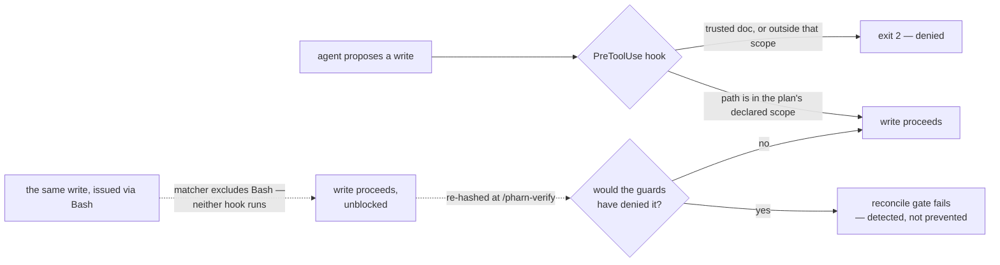

# PHARN guarantees

What PHARN guarantees, the check behind each guarantee, and what stays advisory. This text moved here unchanged from
the root [`README.md`](../README.md) in 6.65.3, apart from re-based links; what PHARN does not do is in
[`limitations.md`](limitations.md).

## Guaranteed vs advisory

This distinction is the core design rule.

A **guarantee** must reduce to a deterministic, non-LLM operation such as a hook decision, content-hash
comparison, enum/set-membership check, regex scan, or filesystem check. Anything that depends on model
judgment is **advisory**.

**Guaranteed** — examples of narrow claims backed by named checkers:

| Guarantee                                                                                                                                                                                                                                                                                                                                                                                                                                                                                                                                                                                                                                                                            | The check behind it                                                                                                                                                                                                                                  |
| ------------------------------------------------------------------------------------------------------------------------------------------------------------------------------------------------------------------------------------------------------------------------------------------------------------------------------------------------------------------------------------------------------------------------------------------------------------------------------------------------------------------------------------------------------------------------------------------------------------------------------------------------------------------------------------ | ---------------------------------------------------------------------------------------------------------------------------------------------------------------------------------------------------------------------------------------------------- |
| The four trusted docs — and the guards' own control surface, and your project's own SPEC template (`pharn.spec-template.md`) — cannot be edited through Claude Code's Write/Edit/MultiEdit/NotebookEdit surface                                                                                                                                                                                                                                                                                                                                                                                                                                                                      | `.claude/hooks/protect-trusted-paths.cjs`                                                                                                                                                                                                            |
| Memory-bank canon (`memory-bank/`, `.dev/memory-bank/`, subtrees included) is denied on that same surface, **unless** the active writes-scope was set by a promotion command **and** names that one canon file alone — so a build plan cannot grant itself a canon write                                                                                                                                                                                                                                                                                                                                                                                                             | `.claude/hooks/protect-trusted-paths.cjs` (origin read from `set-writes-scope.cjs`'s argv)                                                                                                                                                           |
| Writes through that same tool surface — **and only that surface**, since the wired `PreToolUse` matcher does not match `Bash` — are restricted to the active write scope; with none active the default is fail-closed in a dev checkout or an unsignalled tree, and — since 6.24.0 — in an **installed** project too, but **only while a `/pharn-ship`, `/pharn-loop` or `/pharn-review` run is open**; outside a run an installed project's default instead denies PHARN's own reserved surface and its scope file and allows the rest of the project, and outside the project allows only this project's auto-memory folder, this session's own scratchpad and ordinary temp paths | `set-writes-scope.cjs` + `enforce-writes-scope.cjs` + `run-marker.mjs`                                                                                                                                                                               |
| The verify and regress verdicts are computed from a gate map the gate runner wrote, not one a model typed: each value is the exit code the runner recorded for the listed command, the keys cover the resolved gate set (plus `reconcile` for verify, which runs last), and no tree edit happened between consecutive gates                                                                                                                                                                                                                                                                                                                                                          | `run-gates.mjs`, validated by `check-verify.mjs --stamp` and `check-regress.mjs verdict --base-stamp … --head-stamp …`                                                                                                                               |
| A **non-adversarial** write that reached a path the active scope would have **denied** — including one issued through `Bash`, which no hook sees — is **detected** between build and verify, and fails the verify verdict — unless its bytes are exactly the upstream bytes HEAD merged in during that window, which is reported as `merged` instead. Detected, **not** prevented; git-ignored paths are outside the reconciled set; and a writer who also rewrites the baseline defeats it on ordinary paths                                                                                                                                                                        | `reconcile-baseline.mjs --anchor` + `check-bash-reconcile.mjs`, feeding `check-verify.mjs`                                                                                                                                                           |
| An approved spec is pinned, so later body drift is detectable                                                                                                                                                                                                                                                                                                                                                                                                                                                                                                                                                                                                                        | `check-spec.mjs --hash` at approval; re-verified at plan, grill, test, build, regress, verify and ship by `check-spec-approved.mjs` (directly at plan, test and ship; through `check-plan-spec-agree.mjs` at grill, test, build, regress and verify) |
| A SPEC that declares `spec_template` has the template's sections, acceptance criteria each with an id, Given → When → Then and exactly one `verify:` level, and no clarification marker once approved. That the criteria are **phrased** testably — **not** that any test exists, runs, or passes; and opt-in, so a SPEC without the key is checked as before                                                                                                                                                                                                                                                                                                                        | `check-spec.mjs` (the rules in `pharn/pharn-contracts/spec-template.md`)                                                                                                                                                                             |
| A template — the shipped default or your own — is refused before `/pharn-spec` can pin it unless it has the required sections, a visible example criterion, the out-of-scope label and a `spec_template:` line; an existing but invalid project template stops the run instead of falling back to the default. A minimum shape — **not** that a SPEC filled from it will pass                                                                                                                                                                                                                                                                                                        | `check-spec.mjs --resolve-template-ref` (the refusals in `pharn/pharn-contracts/spec-template.md`)                                                                                                                                                   |
| Secret-shaped literals in a plan can be detected by the shipped regex scanner                                                                                                                                                                                                                                                                                                                                                                                                                                                                                                                                                                                                        | `scan-plan-secrets.mjs`                                                                                                                                                                                                                              |
| A missing concrete path declared by the plan, or one it marks `(delete)` that is still present, yields an incomplete build signal                                                                                                                                                                                                                                                                                                                                                                                                                                                                                                                                                    | `check-build-complete.mjs` feeding `check-verify.mjs`                                                                                                                                                                                                |
| `/pharn-build` does not start until every acceptance criterion of a templated SPEC has a test, in the file the mapping names, that was collected and **failed** in a run bound to the pinned test files and the live tree (a `spec_kind: test-infra` SPEC gets a weaker bootstrap lock, labelled as such). That the record says **failed** — **not** why: a test failing on its own typo reads the same                                                                                                                                                                                                                                                                              | `check-test-stage.mjs`, over `check-ac-tests.mjs`, `check-red-run.mjs` and `ac-tests-lock.mjs`                                                                                                                                                       |
| `/pharn-verify` fails unless each acceptance criterion of a templated SPEC has a locked, once-red test titled `AC-<n>:`, in a file mapped to it, that **passed** on the head run — and fails too when those tests, the lock or the pinned test infrastructure changed after `/pharn-test`. That the reporter said **passed** — **not** that the test captures the criterion's intent, and the infrastructure pin covers a closed set of files                                                                                                                                                                                                                                        | `check-verify.mjs --ac-gate` (`ac-gate-core.mjs`)                                                                                                                                                                                                    |
| Which lenses run, and how structured findings merge                                                                                                                                                                                                                                                                                                                                                                                                                                                                                                                                                                                                                                  | `count-lenses.mjs` + `merge-findings.mjs`                                                                                                                                                                                                            |
| The eleven product commands' `model:` / `effort:` frontmatter equals what `pharn.config.json`'s `models.stages` resolves for that stage — not that the stage ran under it                                                                                                                                                                                                                                                                                                                                                                                                                                                                                                            | `check-model-config.mjs`                                                                                                                                                                                                                             |
| A run's `cost.json` is **internally consistent**: a closed top-level key set, every aggregate equal to a recompute from the recorded requests, unique request ids, a strictly increasing marker sequence, no absolute path anywhere, and every row inside the run window recomputed from its own recorded markers and, since 6.29.0, from a context in its own recorded context set. Consistency only — **not** that the numbers describe the run, nor that the recorded markers and contexts are the run's                                                                                                                                                                          | `check-cost-ledger.mjs`                                                                                                                                                                                                                              |

**Advisory** — everything a model judges: whether a plan is wise, whether a review finding is real,
whether a severity is right, whether the code satisfies the product intent, and whether the resulting
system is well designed. These findings are surfaced for a human; they are not converted into guarantees
by wording them strongly.

**Important bounds:**

- The write guards cover Claude Code's Write/Edit/MultiEdit/NotebookEdit tool surface.
  **Writes performed through Bash bypass those hooks.**
- `scan-plan-secrets` detects configured patterns; it does not prove that a matched literal is a live
  secret or that an unmatched plan contains none.
- `check-build-complete` proves that declared concrete paths exist, and that paths the plan marks `(delete)` do not.
  It does not prove that the build modified them, deleted them, or that their contents are correct.
- `check-cost-ledger` certifies that a `cost.json` agrees with itself. It does **not** bind the recorded
  requests to the session that produced them, so a self-consistent fabricated ledger passes — a test in
  the repository proves it by building one. The `--verify-transcript` flag re-derives the rows from the
  live transcript, but a transcript is machine-local and Claude Code prunes it on its own schedule, so
  that check is deliberately not a gate. The ledger annotates a run; it gates nothing.
- A validating gate-run stamp proves internal consistency, not provenance. A self-consistent fabricated
  stamp passes, and a test in the repository builds one to prove it. The stamp alone also says neither
  that the stage ran nor that the report on disk is its output. Under `/pharn-loop`, `check-loop-fresh.mjs`
  narrows that by binding each report to its stamp by hash and the verify stamp to the live tree. That is
  tree identity, not recency.
- `check-model-config` compares two files. Model and effort are applied by the Claude Code platform, so
  nothing here observes that a stage ran under the configured model — and an org `availableModels`
  allowlist or auto mode can decline a value silently.
- A green PHARN floor means the named deterministic checks passed. It does not mean the code is correct.

See [`LIMITS.md`](../LIMITS.md) for the full set of bounds.

## Why not just CLAUDE.md or AGENTS.md?

Keep them. PHARN is not a replacement for a project instructions file.

`CLAUDE.md`, `AGENTS.md`, and similar files are instructions the model may follow. PHARN adds versioned
workflow artifacts plus deterministic checks that do not depend on the model deciding that a sentence
should be obeyed.

- **A file states a rule. A hook can enforce one.** PHARN's `PreToolUse` hooks can deny writes through
  Claude Code's standard write/edit tools.
- **Approval becomes an explicit workflow gate.** A spec remains `Draft` until the user explicitly
  approves it. Downstream stages refuse a Draft or drifted spec.
- **Approved intent is pinned.** A content hash makes later edits to the approved spec body detectable.
- **Findings cite stable rule IDs.** A review finding names the rule it violates instead of relying on
  remembered chat context.
- **Guaranteed decisions avoid free-text judgment.** Deterministic gates operate on paths, hashes,
  enums, regex matches, exit codes, and other bounded values rather than asking the model whether
  something "looks safe."

PHARN still relies on agent orchestration to invoke parts of the workflow. It does not turn an LLM into
a trusted execution environment.
