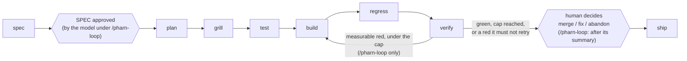

# PHARN pipeline

How a PHARN run moves through its stages, what binds them, what your project needs for the test stage, and which
grillers and lenses it applies. This text moved here unchanged from the root [`README.md`](../README.md) in 6.65.3,
apart from re-based links and one "below" that pointed at the README's own layout.

## How the workflow works

PHARN splits an AI-assisted change into typed stages:

1. **Spec** — turn prose intent into `SPEC.md`, surface gaps, and stop for approval.
2. **Plan** — turn the approved spec into `PLAN.md`, including the concrete files the build may touch.
3. **Grill** — interrogate the plan before code exists.
4. **Test** — write each acceptance criterion's test, run it, and require it to fail before any code exists.
5. **Build** — implement the plan. With the hooks wired as they ship, Claude Code write/edit tools are
   denied outside the active scope, in whichever working tree Claude is currently in.
6. **Regress** — re-run existing project suites and record breakage outside the feature. The comparison base is
   the commit `/pharn-ship` and `/pharn-loop` captured before the build. Run alone, `/pharn-regress` picks one
   (HEAD on a dirty tree, else the merge-base with `origin/main`) and records which; pass `--base` once any of
   the build is committed, or the committed part sits inside the base (a fully committed build is refused as having
   nothing to compare).
7. **Verify** — run the project's gates, check declared artifacts and completeness signals (including missing
   concrete paths), and check that each acceptance criterion's locked test now passes.
8. **Ship** — write the ship/briefing artifacts and present the final human decision gate.

The approved spec body is pinned by a content hash, so later drift is detectable. Verification can also
report `INCOMPLETE` when a concrete path declared by the plan does not exist after the build.

Those are narrow checks, not magic. PHARN does not prove that the plan was wise, that every finding is
correct, or that the final code is secure. It makes the workflow legible and backs specific claims with
specific deterministic checks.

## The pipeline

Eight typed stages, each emitting a typed artifact:



**What binds the chain is the SPEC→PLAN content-hash, not a field on every artifact and not a
stage-to-stage handoff.** Identity travels as the feature slug — `spec_id` ≡ `<name>` ≡ the feature
directory — and `check-plan-spec-agree.mjs` re-verifies the pin at **five** downstream stages (grill,
test, build, regress, verify). A literal `spec_id` field appears in `SPEC.md` (the root identity, read by
`check-spec.mjs --spec-id`), `PLAN.md` and `BRIEFING.md` — not on every artifact.

Stages do **not** each read the previous one's output. `/pharn-regress` reads the plan to derive the
inside/outside scope boundary; `/pharn-verify` reads the plan, its own gates and, for the acceptance-criteria
check, the SPEC's criteria, `AC-TESTS.md` and the lock, and it **does not read `regression-report.json` at all**. The stage that reads everything is `/pharn-ship`, which orchestrates
the chain and preserves two human decision points: explicit spec approval before planning, and the
final merge/fix/abandon decision after verification.

The orchestration itself is not a deterministic guarantee: the agent invokes the stages. The proceed/stop
decisions inside the pipeline are read from the deterministic verdicts emitted by the relevant checkers.

`/pharn-loop` runs the same chain without either human gate. The model approves the spec, and the build →
regress → verify middle repeats until a deterministic stop: green, the iteration cap, or a red it must not
retry (an inconclusive result; a reconcile red — a retry would re-anchor the baseline and erase the
detected escape; or, since 6.20.0, acceptance-criterion evidence that changed after `/pharn-test`, which another
build cannot restore — `blocked: ac-evidence-invalid`). Before it reads that stop, and again before it commits, `check-loop-fresh.mjs` checks that
the evidence belongs to the tree: each report must be its checker's output from a stamp that validates, bound
to it by hash, and the verify stamp must describe the live tree. A skipped or stale stage is re-run inside
the same iteration under a counted budget. A forged verdict or a spent budget ends the run as a recorded
blocked stop, not as a summary that names the skipped gates. That is tree identity, not recency: an iteration
whose build changed nothing can still reuse the previous iteration's evidence. Only a green result is
committed, to a new local branch, and only if its recorded decision re-derives from the reports it cites
(`check-loop-decision.mjs` re-runs the loop's stop computation and compares); a green that does not
re-derive is not committed. None of this proves the reports are honest: a self-consistent forged set of
stamps and reports still passes. Every other outcome reverts a
model-approved spec to `Draft`, or the run says it could not; a spec the run never approved (a stop on a
clarification marker, say) simply stays a `Draft`. The human decision comes after the run, on the branch or the
working tree it leaves.

**Standalone:** `/pharn-review` is not a pipeline stage. It runs review lenses in parallel as subagents
and merges their structured findings deterministically. You can run it against code independently of the
shipping pipeline.

### Your own SPEC template

`/pharn-spec` fills PHARN's default SPEC template unless your project has its own. To use your own, copy
`pharn/pharn-contracts/templates/spec-template.md` to `pharn/spec-template.md` and edit it
there: rename or reword sections, change the guidance comments, adjust the example. `/pharn-spec` then picks it
up on its next run, and every SPEC it writes records `project@sha256:…` as its template.

Edit that file yourself, outside Claude Code's write tools. This is by design: its guidance comments are
instructions `/pharn-spec` follows, so the path is fixed and the write guard denies Write/Edit to it, whether or
not the file exists. An existing install gets that protection when `pharn update` replaces the hook script. A
Bash write is not blocked (see [Current limitations](limitations.md#current-limitations)), and neither is a change that
arrives by pull request or `git pull`: review edits to this file like code.

Before `/pharn-spec` fills a template it is checked. It needs the five required sections (Intent, Scope,
Acceptance Criteria, Constraints, Assumptions) as visible headings, one example criterion in the `- **AC-<n>**
Given … When … Then …` shape with one `verify:` line, the `**Out of scope…**` label under Scope, and a
`spec_template:` line in its frontmatter. It must also be a regular file named exactly `pharn/spec-template.md`,
not a symlink, and PHARN's own `pharn/` must not be reached through a symlink. If your template fails, `/pharn-spec` stops and names the reason; it does not fall back to the
default. Deleting the file later switches future SPECs back to the default, and it does not affect SPECs
already approved.

### Per-test results

A gate's exit code says whether the whole suite passed, not whether one named test ran: a suite exits 0 with
a skipped test. PHARN can also read a per-test record — each test's id, file, title and `passed`, `failed` or
`skipped` — from a JSON report your test runner writes. `/pharn-test` reads it, and since 6.20.0 so does
`/pharn-verify`'s acceptance-criteria check (both below).

To turn it on, name your reporter's format for each gate in `pharn.config.json`. The gates are `test` and the
e2e gates (`test:e2e`, `e2e`). The formats:

- `vitest-json`, `jest-json` and `playwright-json` are each their runner's own built-in report, so there is
  nothing to install.
- `pharn-json` is a neutral format PHARN defines. Use it for any other runner.

For example:

```json
{ "testResults": { "test": "vitest-json", "test:e2e": "playwright-json" } }
```

An e2e gate exists only when your `package.json` has a `test:e2e` or `e2e` script. `/pharn-verify` runs it after
`build`, last among your project's gates; `/pharn-regress` never discovers it (a gate you name yourself with
`--gates` still runs). It gets the same per-gate time limit as every other gate (540 s), and
under `/pharn-loop` it runs on every iteration. Starting servers and installing browsers stay your script's job.

Then have the reporter write to the path PHARN passes in `PHARN_TEST_RESULTS`. PHARN sets that variable only
while its own stages run your gates, so an ordinary test run is unchanged. With vitest:

```js
// vitest.config.js
import { defineConfig } from "vitest/config";

const results = process.env.PHARN_TEST_RESULTS;
export default defineConfig({
  test: {
    // ...your other test options...
    ...(results ? { reporters: ["default", "json"], outputFile: { json: results } } : {}),
  },
});
```

With Playwright:

```js
// playwright.config.js
const { defineConfig } = require("@playwright/test");

const results = process.env.PHARN_TEST_RESULTS;
module.exports = defineConfig({
  // ...your other options...
  ...(results ? { reporter: [["list"], ["json", { outputFile: results }]] } : {}),
});
```

With Jest (`"test": "jest-json"`), which has no config option for its JSON report, add the flags in the script.
The `${…:+…}` form adds them only while the variable is set:

```json
{
  "scripts": {
    "test": "jest ${PHARN_TEST_RESULTS:+--json \"--outputFile=$PHARN_TEST_RESULTS\"}"
  }
}
```

That form needs a POSIX shell. On Windows npm runs scripts under `cmd.exe`, which hands the text to Jest
unexpanded. Things to know about Jest:

- Name `jest-json`, not `vitest-json`. `vitest-json` also parses Jest's report, because vitest copies its shape. But
  it skips Jest's retry and `test.failing` fields, so under it those tests read as passes.
- The record was checked on Jest 29.7.0 and 30.5.2. A report from a Jest that does not write `invocations` is
  refused rather than guessed.
- Jest reads the file arguments PHARN passes as path patterns, so a similarly named test file can run too, and its
  tests enter the record. Jest's `--runTestsByPath` makes them exact paths.
- The lock's test-infrastructure pin covers a `jest.config.*` file and, since 6.31.0, a `jest` key inside
  `package.json` too.

For any other runner, write a small reporter that emits `pharn-json`. The schema, with an example, is in
`pharn/pharn-contracts/test-results-record.md`, "The neutral format". Name the reporter file literally in the `test`
script (`--reporter=./tools/pharn-reporter.mjs`, say): since 6.31.0 the lock pins every file a test script names
that way, and a plan that puts it in the build's scope is refused.

What the record can and cannot tell you is in `pharn/pharn-contracts/test-results-record.md`. In short, "passed"
means your reporter said so. A flaky test or an expected failure that the report marks is never counted as a pass:
Playwright's `flaky` and `test.fail()`, Jest's pass on a retry, and Jest 30's `test.failing`. Since 6.31.0 the record
lists such a test, and every test name two tests share, as an **anomaly** beside the tests it can read. An anomaly
decides a criterion only when it sits in a file that criterion maps, and is reported otherwise — before, one anywhere
in the suite voided the whole record. One the report does not mark reads as a pass. Measured cases are vitest's
`test.fails` and pass on a retry, and Jest 29's `test.failing`. `pharn.config.json` is not write-protected, so review
changes to it like changes to your test script.

### Excluding a gate (6.36.0)

If one of your gates cannot run on your machine — an `e2e` suite that needs more memory than it has, say — leave it
out of discovery in `pharn.config.json`:

```json
{ "gates": { "exclude": ["e2e"] } }
```

Each id must be one of the gates PHARN discovers (`test`, `lint`, `format:check`, `lint:md`, `typecheck`,
`type-check`, `build`, `test:e2e`, `e2e`). Anything else stops the run with an error, and so does a
`pharn.config.json` that is not valid JSON. The rules:

- `/pharn-regress`, `/pharn-verify` and `/pharn-test`'s red run then skip that gate. A list you pass yourself with
  `--gates` is never filtered.
- Every verify and regression report says which gates were excluded, directly under its verdict. A PASS over fewer
  gates means less than a full PASS: an excluded gate is not evidence either way.
- **Declare it and commit it before the run.** `/pharn-test` pins the list, so a change made during the build fails
  verify. An uncommitted change also reads as the build writing outside its plan.
- A criterion whose level only an excluded gate runs (an `e2e` criterion with `e2e` excluded) is refused at
  `/pharn-plan`. Re-specify it at another level, or keep the gate.

### Declaring the base install (6.66.0)

`/pharn-regress` installs dependencies into a checkout of the base commit with your one lockfile's frozen command
(`npm ci`, …). With no lockfile, or with two lockfile families, it has to ask how — and `/pharn-loop` cannot ask, so
it stops. Declare the answer once in `pharn.config.json`:

```json
{ "regress": { "install": "head-node-modules" } }
```

- `npm`, `pnpm`, `yarn` or `bun` — use that family's frozen install (its lockfile must be in the base commit).
- `none` — install nothing. If your project declares dependencies, a gate that needs them is red at the base, and a
  gate red at both base and head stops the stage (`base-install-unreliable`).
- `head-node-modules` — install nothing, and let the base checkout use your project's installed `node_modules`. The
  base is then measured with your current dependencies, so a regression caused only by a dependency change is not
  attributed to the change; the report says so. This is the usual choice for a library that commits no lockfile.

A `--install` or `--no-install` you pass yourself wins. Commit the declaration before the run, as for
`gates.exclude`.

### Acceptance-criteria tests, before the build

For a SPEC filled from the template, `/pharn-plan` maps each acceptance criterion to a test file and the public
interface it drives (`AC-TESTS.md`), and `/pharn-test` writes those tests **before** `/pharn-build`, into files the
build is not allowed to write. Since 6.18.0 it also **runs** them and requires every criterion's test to **fail**:
a test that cannot fail, is never collected, or is skipped would otherwise pass unnoticed. The evidence — which
tests failed, bound to the files it pinned — goes into the committed `AC-TESTS.lock.json`. Since 6.19.0
`/pharn-ship` and `/pharn-loop` run it between `/pharn-grill` and `/pharn-build`, and `/pharn-build` refuses to start
until `check-test-stage.mjs` reads that evidence as complete. A feature planned or tested before 6.19.0 has to go
back through `/pharn-plan` and `/pharn-test` before it builds.

What it needs from your project:

- **A runner for each criterion's level, with per-test results.** `unit` and `integration` criteria run under your
  `test` script, `e2e` ones under `test:e2e` or `e2e`, and each of those gates needs its reporter configured as in
  [Per-test results](#per-test-results). Without them `/pharn-test` stops before writing anything and says which
  criterion has no runner. Set the runner up first, as its own increment: a SPEC with `spec_kind: test-infra` in its
  frontmatter gets a **bootstrap** lock instead — no tests before the build, which is weaker, and the lock says so.
- **Tests that import their target inside the test body.** Before the build the module under test does not exist.
  `await import("../src/reset.js")` inside the test makes that a failed test, which is what the red run wants; a
  top-level `import` makes the whole file fail to load, so none of its tests is collected, and the red run refuses
  that as the wrong reason. `/pharn-test` writes them this way. The form must be one your runner can run, or the
  test fails before and after the build alike. Plain Jest in its default CommonJS mode cannot run an in-body
  `await import()`, so there `/pharn-test` uses `require()` inside the test; Jest's ESM mode is the reverse. A
  runner that type-checks each file as it loads it (ts-jest with diagnostics on, for example) fails the file anyway;
  use its transpile-only mode.
- **An e2e runner that serves the app itself.** The red run does not run `build`; Playwright's `webServer` option
  is the usual way.

A criterion's test that already **passes** before the build is refused, with no override: either the test is
vacuous, or the behaviour exists and the criterion restates it. What the red run proves is limited to what the
record shows. "Failed" is the runner's status, so a test that fails on a typo of its own reads the same as one
that fails because the feature is missing. Details: `pharn/pharn-contracts/ac-tests.md`.

### What verify proves about acceptance criteria

Since 6.20.0 `/pharn-verify` checks each criterion, not only whole gates. **An AC is delivered = a locked, once-red
test titled `AC-n:`, in a file mapped to AC-n, passed on the head run. PHARN does not judge whether that test fully
captures the AC's intent.** The match is by file, so another feature's `AC-1:` in the same suite never counts. The
verify report carries a per-AC table (id, level, matched tests, status, reason), and `RUN-REPORT.md` shows it.

- **An AC not delivered yet** (its test is missing from the run, failed, or skipped) fails verify, and `/pharn-loop`
  builds again, like any failing gate.
- **AC evidence that changed** fails verify and stops `/pharn-loop` (`blocked: ac-evidence-invalid`): a pinned test
  or the lock was edited, the tests were never shown red, or the test infrastructure moved. Another build cannot fix
  that. `/pharn-test` now also pins what runs the tests: the level gates' `package.json` scripts (with their
  `pre`/`post` scripts), their `testResults` format, and root `vitest`/`vite`/`playwright`/`jest` config files — and,
  since 6.31.0, the scripts those chain to (`npm run test:unit`), the files they name (your reporter, a runner
  script), a `jest` key in `package.json`, and a root `.npmrc`/`.yarnrc`/`.yarnrc.yml` — and, since 6.36.0, the
  `gates.exclude` list in `pharn.config.json` ("Excluding a gate", above) — and, since 6.68.0, the script (with its
  `pre`/`post` scripts) of every other allowlisted gate verify runs (`lint`, `typecheck`, `build`, `format:check`,
  `lint:md`) and the scripts those chain to; for those gates only the command is pinned, not the files or configs it
  reads. A plan may not put the
  named files, those configs or the feature's own lock in the build's scope; it may still name `package.json` (a
  dependency is ordinary build work), and a change there to anything the lock pins fails verify. What the pin does not see — code the build writes can still
  switch off assertions or the reporter from inside the test process, and a setup file a config imports,
  environment-driven configuration, a chain through another runner, `tsconfig` and the runner's version are unpinned
  too — is listed in `pharn/pharn-contracts/ac-tests.md`. After the build, re-running `/pharn-test` means setting the
  build aside first, because its red run would now pass.
- **What the wider pin costs (6.31.0).** A source file a test script names literally is pinned too — a bundler entry
  reached through `"pretest": "npm run build"`, a runner script — so a feature that edits it fails verify with
  `test-infra-changed`; name a directory, a glob or a config file there instead, as its own `spec_kind: test-infra`
  increment. The lock records a digest of `.npmrc`: keep registry credentials in an environment variable or your
  user-level npmrc, never in the project's.
- **A feature locked before 6.20.0** has no infrastructure pin, and verify reports `test-infra-unpinned` until it goes
  back through `/pharn-test` that way. **A feature locked by 6.20–6.29** keeps its lock; verify reports
  `test-infra-unpinned` only if its test scripts chain to another script, name a file, or read a `jest` key or a
  package-manager config — the things only the 6.31.0 lock pins — and `test-infra-changed` if the 6.31.0 pin cannot be
  taken over its tree at all (a symlinked `.npmrc` or named file, a chain deeper than 8 scripts), which no 6.31.0 lock
  could record either.
- **A per-test record that cannot be read** makes verify inconclusive, never a pass. A flaky test, an expected
  failure the report marks, or a duplicate test name makes a criterion inconclusive only when it sits in that
  criterion's test file; anywhere else it is listed in the report and decides nothing (6.31.0 — see
  [Per-test results](#per-test-results)).
- **A SPEC not filled from the template** is reported `not-applicable (legacy spec)` in the report, not silently
  passed. A `spec_kind: test-infra` SPEC gets **bootstrap** evidence: the level's gate ran and reported at least one
  passed test. That is weaker, and the report says so.

## Quick mode

For a small, well-scoped change, `--quick` (6.25.0) runs a shorter spine — both human gates, a
`spec_kind: quick` mini-SPEC of 1–3 criteria, the grill's two floor stops without its interrogation,
test-first evidence and `/pharn-verify` — and skips `/pharn-regress`'s base-and-head comparison, the plan
interrogation, `BRIEFING.md` and `RUN-REPORT.md`. Its ship record lists what it did not check, and a file the
run changed outside the plan's declared files still stops the run (`/pharn-regress`'s scope check is kept).

```text
/pharn-ship --quick fix the off-by-one in the pagination cursor
```

`--quick` counts only as the first token of the arguments. That rule is an instruction to the orchestrating
model, not a parser, so it is advisory. The deterministic backstop is the SPEC: quick mode first reads the
approved, pinned `spec_kind` and stops on anything but `quick`, so a misread `--quick` over a full SPEC meets
that stop. It cannot tell a typed `--quick` from a misread one over a SPEC you already approved as quick.

The unattended loop has the same mode (6.28.0), without the human gate:

```text
/pharn-loop --quick fix the off-by-one in the pagination cursor
```

The model writes **and** approves the quick SPEC, so nobody is told the trade before the run; an intent that does
not fit a quick SPEC stops the run (`blocked: not-quick`) instead of widening into a full one. Every iteration skips
`/pharn-regress`'s base-and-head comparison and keeps its scope check, and the stop is decided over `/pharn-verify`'s
verdict alone — in a table the SPEC's pinned kind chooses, never the flag. Its green is `STOP_GREEN_QUICK`, which is
not `STOP_GREEN`; the record (`LOOP.md`, `mode: quick`), the commit message and the summary name the mode and list
what was not checked. It writes `cost.json` but no `RUN-REPORT.md`.

### Running /pharn-loop in a container

An unattended `/pharn-loop` runs your project's tests and the code its build wrote with nobody watching, and PHARN
cannot sandbox the shell it uses ([`pharn/LIMITS.md`](../pharn/LIMITS.md) §6). So since 7.1.0 the loop's first step,
`pharn/floor/check-run-isolation.mjs`, refuses to start (`blocked: not-isolated`) unless it finds a container marker
(`/.dockerenv`, `/run/.containerenv`, a container runtime in `/proc/1/cgroup`, a dev-container, Codespaces, Gitpod
or GitHub Actions variable, or `PHARN_ISOLATED=1`) and none of the credentials it lists (`~/.ssh`, an SSH agent, gh,
git credentials and helpers, `.netrc`, AWS, npm tokens and a few deploy-platform tokens). Pass
`--accept-host-execution` before the description to run anyway; the record, the run report and the commit message
then say so. The full lists and their reasons are in
[`loop-record.md`](../pharn/pharn-contracts/loop-record.md), "The isolation field".

The check reads a fixed list, so it is not proof of isolation. A credential it does not list (a project `.env`, a
keychain, a cloud metadata endpoint) is not seen. A container it does not recognize (containerd or Kubernetes on
cgroup v2, where `/proc/1/cgroup` reads `0::/`) needs `PHARN_ISOLATED=1`, which is your assertion, not a detection.
Claude Code's own credential (`ANTHROPIC_API_KEY`) is always present, so a compromised run can still send data out
through it.

An example, illustrative and **advisory**: no file in this repository builds or checks it. It mounts only the
repository and passes only the model credential:

```bash
docker run --rm -it \
  -v "$PWD":/work -w /work \
  -e ANTHROPIC_API_KEY \
  -e GIT_AUTHOR_NAME="pharn-loop" -e GIT_AUTHOR_EMAIL="pharn-loop@localhost" \
  -e GIT_COMMITTER_NAME="pharn-loop" -e GIT_COMMITTER_EMAIL="pharn-loop@localhost" \
  node:24 bash -c 'npm install -g @anthropic-ai/claude-code && claude'
```

Git gets its identity from the environment, not from a mounted `~/.gitconfig`. A mounted config would bring its
credential helper (refused as `cred:credential-helper`) and its signing settings: with `commit.gpgsign=true` and no
signing key in the container, the loop's green commit fails and the run ends `not committed: commit failed`. Inside
the container, run `/pharn-loop <description>` as usual. The green branch it commits lives in the mounted repository;
nothing is pushed.

## Capability coverage

Capabilities are named for the problem they inspect, not the framework they run in. Grillers interrogate
a **plan** before implementation; lenses read **code** after implementation or during standalone review.

**Grillers** — a11y, architecture, comprehension, coupling, documentation, error-handling, i18n,
migrations, observability, performance, privacy, security, testability.

**Lenses** — injection, SSRF, path traversal, insecure crypto, unsafe deserialization, secrets in code,
input validation, hallucinated APIs, missing `await`, missing timeouts, null dereference, off-by-one,
race conditions, resource leaks, swallowed exceptions, missing error handling, n-plus-one queries,
duplicated logic, copy-paste drift, magic values, placeholder-as-done, and a trust fence.

Every capability ships with eval cases and expected outputs. The floor refuses a capability whose
declared rules are not exercised by at least one eval.

This section is a tour, not the authoritative inventory. The drift-guarded lists are generated from the
repository: [`docs/capabilities/`](capabilities/README.md) and the
[current-state block](../README.md#pharn-builds-pharn) in the README.
